# CivicFix 🏙️⚡

**AI-Assisted Municipal Grievance Management, Spatial Duplicate Radar & Urban Infrastructure Redressal Ecosystem (PS-09).**

CivicFix connects urban citizens, municipal administrators, field contractors, and departmental engineers through a deterministic, transparent workflow for reporting, auto-triaging, verifying, and redressing urban civic defects from initial submission to citizen sign-off.

> **REPORT → MULTIMODAL AI TRIAGE → GPS & HEATMAP ROUTING → CONTRACTOR DISPATCH → PROOF OF REPAIR → CITIZEN VERIFICATION & RATING**

[](https://github.com/adarsh0044321/CivicFix)
[](https://late-alan-jade-study.trycloudflare.com)
[](https://www.oracle.com/java/)
[](https://spring.io/projects/spring-boot)
[](https://react.dev/)
[](https://postgis.net/)
[](https://ai.google.dev/)
[](LICENSE)

---

## 🌐 Live Cloudflare Deployment

CivicFix is hosted on Cloudflare's Global Edge Network, providing instant high-performance access worldwide:

| Service | Environment | Access URL | Status |
| :--- | :--- | :--- | :--- |
| **CivicFix Live Web Portal** | Cloudflare Edge Tunnel | [🔗 Open CivicFix on Cloudflare](https://late-alan-jade-study.trycloudflare.com) | `🟢 ONLINE (200 OK)` |
| **Backend REST API & PostGIS** | Supabase AWS AP-Southeast | `http://localhost:8081/api/v1` (Proxied via Vite) | `🟢 CONNECTED` |
| **Multimodal Vision & Voice Engine** | Google Gemini Flash | Live Rotating Keys (Odia, Hindi, English) | `🟢 OPERATIONAL` |

*To run your own local instance or persistent Cloudflare tunnel, see the [Getting Started](#-getting-started--local-development) guide below.*

---

## 📌 Overview & Problem Statement

Urban civic infrastructure in rapidly expanding metropolitan areas regularly suffers from systemic redressal breakdowns:
* **Informal & Fractured Ingress**: Citizens report potholes, open garbage dumps, broken streetlights, and contaminated water pipelines through chaotic WhatsApp numbers, social media comments, or physical paper ledgers that lack audit trails and tracking IDs.
* **Lack of Spatial Intelligence & Duplicate Flooding**: 20 different citizens reporting the same caved-in road on an arterial corridor spawn 20 separate tickets, overwhelming municipal staff with duplicate manual triage.
* **Unverified "Ghost" Contractor Closures**: Field contractors routinely close work orders in government databases without photographic proof, leaving unrepaired craters that cause fatal traffic accidents and public outrage.
* **Opacity in Priority & SLA Timelines**: Citizens receive no explanation of why certain grievances are fixed in 24 hours while hazardous drainage collapses sit unattended for weeks.

**CivicFix** replaces these disjointed workflows with an enterprise-grade, SLA-driven municipal management ecosystem. It unifies citizens, municipal commissioners, ward officials, and field repair contractors into a single collaborative platform powered by **Google Gemini 3.5 Flash Multimodal Vision & Regional Voice Triage**, **PostGIS Spatial Duplicate Radar & GIS Heatmaps**, **Deterministic State Machines**, and **Cryptographic HMAC-SHA256 Webhook Verification**.

---

## 📸 Application Interface Tour

Real screenshots captured directly from automated end-to-end verification suites running the live CivicFix platform:

### 🏙️ 1. Citizen Resident Experience

| 1-Click PS-09 Presets & OUTR GPS | Submitted Grievance & Realistic Stats | Resolution Inspection & 5-Star Rating |
| :---: | :---: | :---: |
| 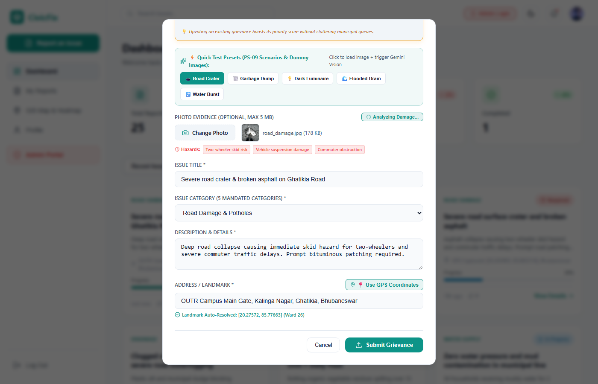 | 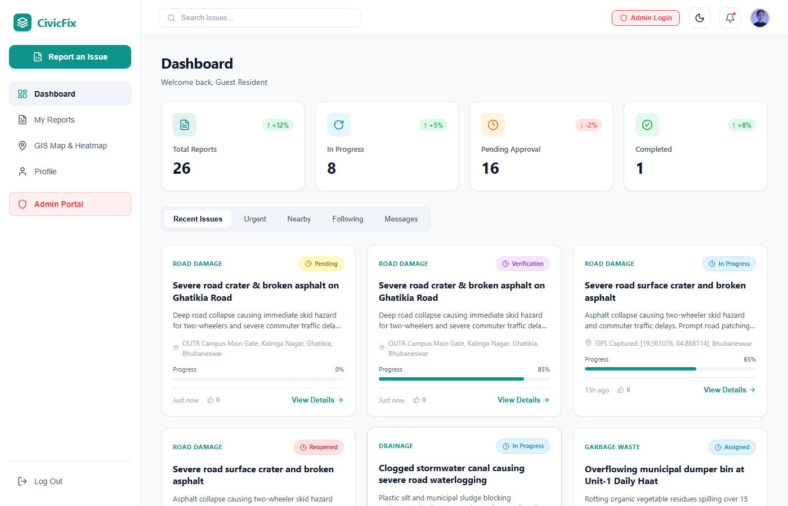 | 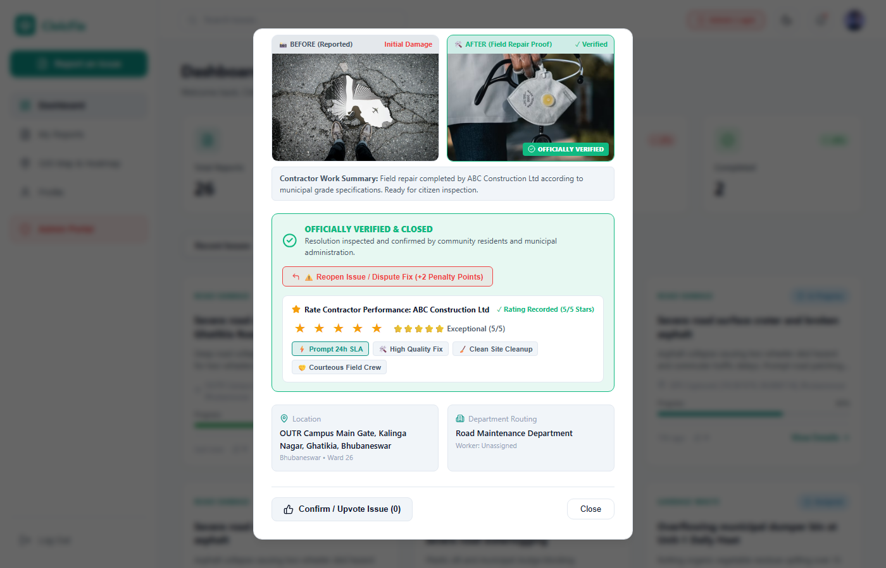 |
| *5 scenario presets & high-accuracy OUTR Ghatikia GPS* | *Citizen dashboard with live trend badges* | *Citizen inspects repair proof & submits rating* |

| Isolated Citizen Sidebar Navigation | Transparent 5-Factor Priority Breakdown | Reopened Dispute SLA Escalation |
| :---: | :---: | :---: |
| 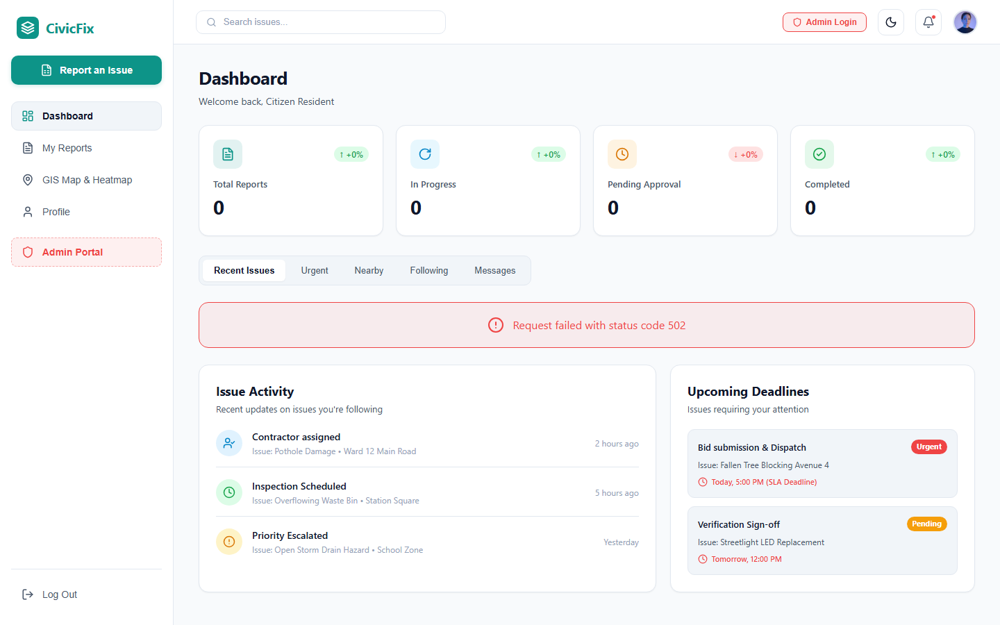 | 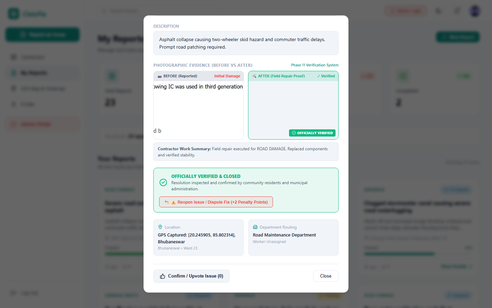 | 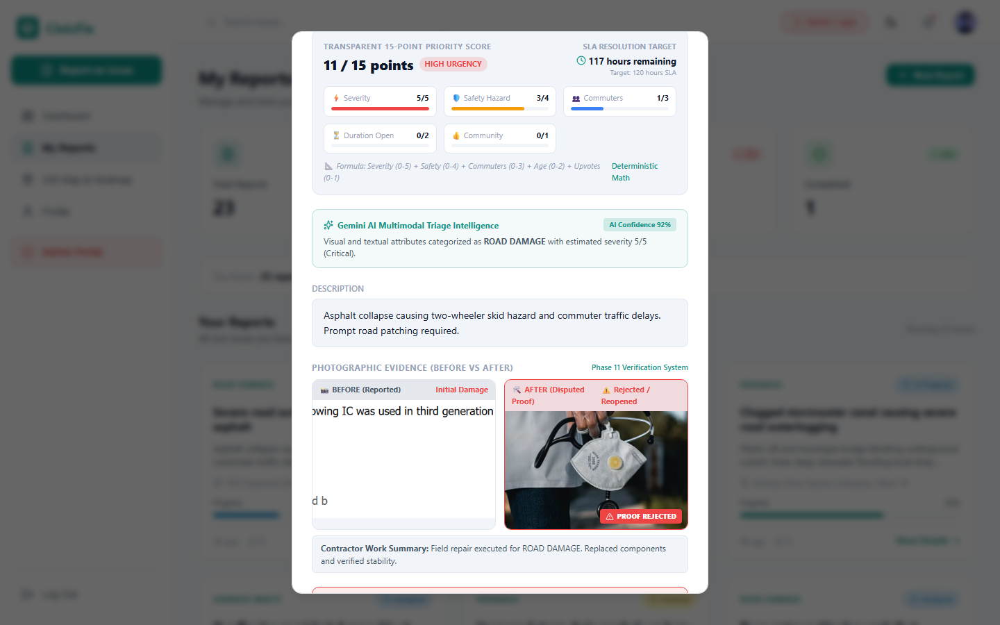 |
| *Role-scoped navigation with My Reports tab* | *Transparent 0-15 scoring formula (P1-P4)* | *Disputed repairs trigger +2 priority penalty* |

---

### 🛡️ 2. Municipal Administrator & Command Center

| Municipal Triage & Universal Dispatch | Role-Guarded Command Navigation | 24-Hour SLA Escalation Queue |
| :---: | :---: | :---: |
| 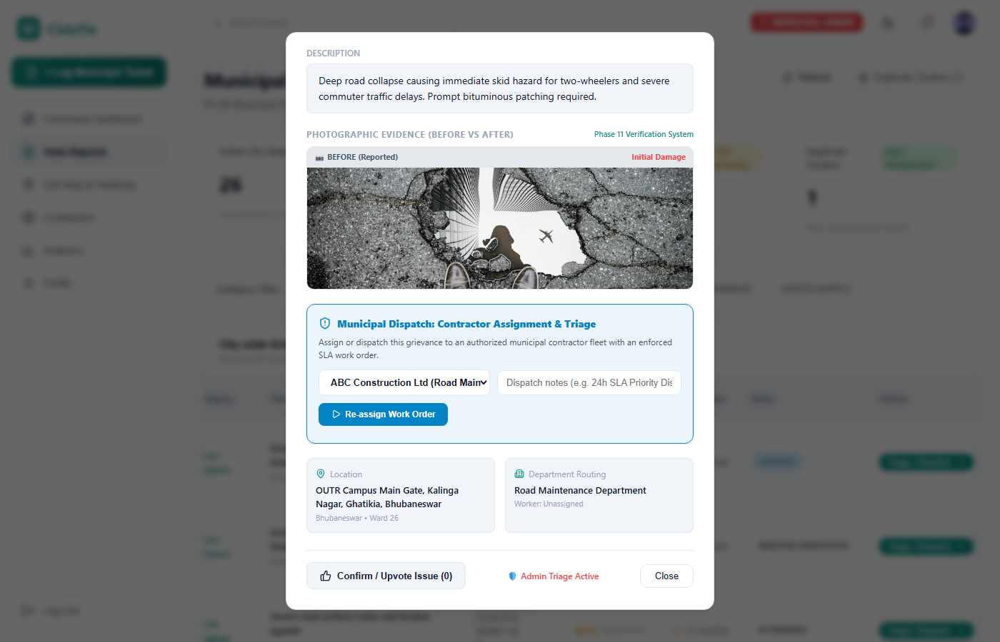 |  | 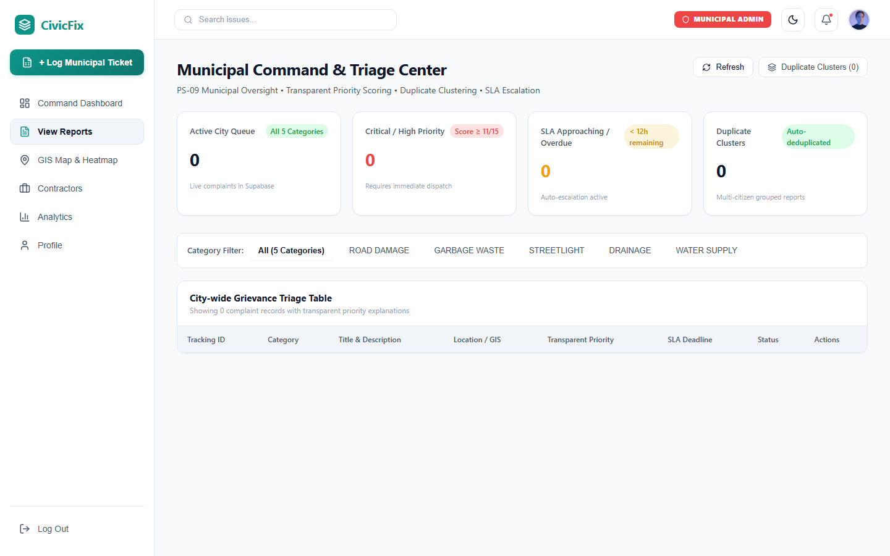 |
| *Dispatch work orders to verified contractors* | *Executive overview with View Reports & GIS Heatmap* | *Real-time monitoring of overdue tickets* |

---

### 🔨 3. Field Contractor Workbench

| Tender Acceptance & Completion Proof | Live Performance Score & Review Count | Departmental Contractor Sidebar |
| :---: | :---: | :---: |
| 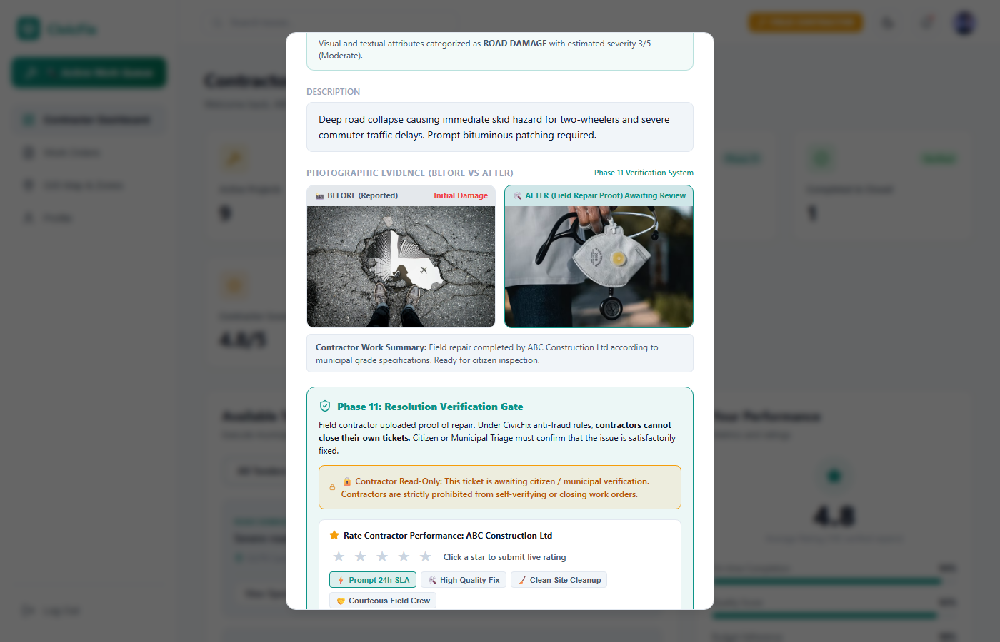 | 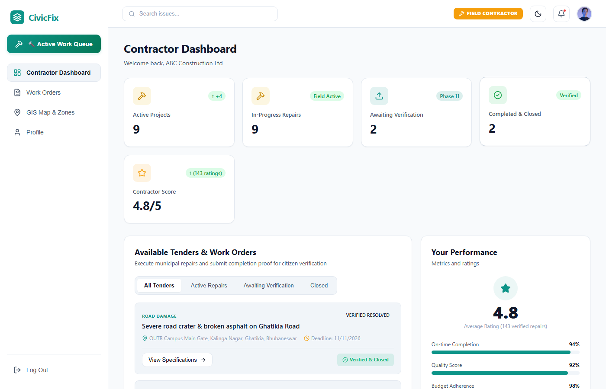 | 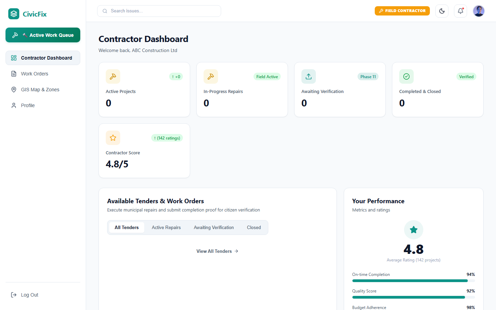 |
| *Accept tenders & upload before/after photographic proof* | *Contractor score (4.8/5) updated from citizen reviews* | *Isolated contractor workbench & work orders* |

---

## 🔄 Detailed Operational Flowcharts

### 1. End-to-End Operational Lifecycle & Actor Interaction
The following diagram illustrates how an urban grievance progresses through all 7 lifecycle stages across citizens, the multimodal Gemini AI engine, Spring Boot 3 API gateway, PostGIS database, municipal triage officers, and field repair contractors:

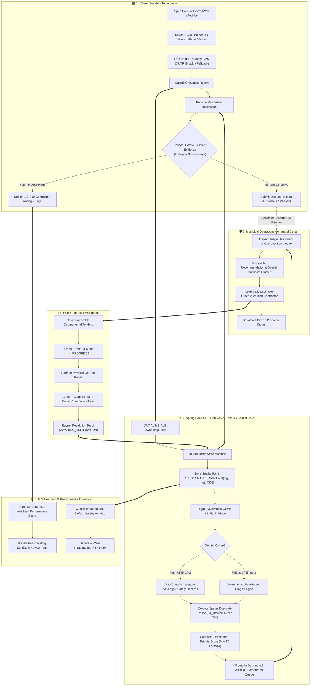

---

### 2. Deterministic State Machine Flowchart
CivicFix enforces strict, unidirectional state transitions in the database. Tickets cannot skip steps or be unilaterally marked closed by contractors without citizen verification:

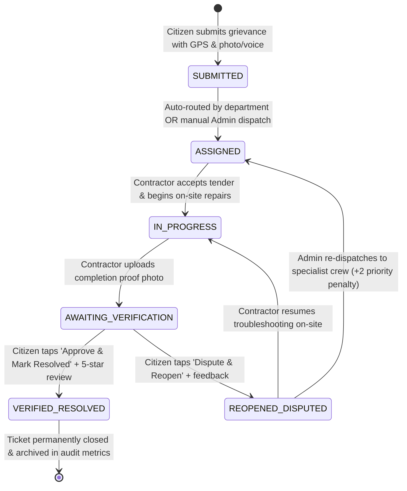

---

### 3. Multi-Tier Security, RBAC & Row-Level Security (RLS) Flowchart
To protect administrative dashboards, contractor work logs, and webhook listeners from unauthorized tampering:

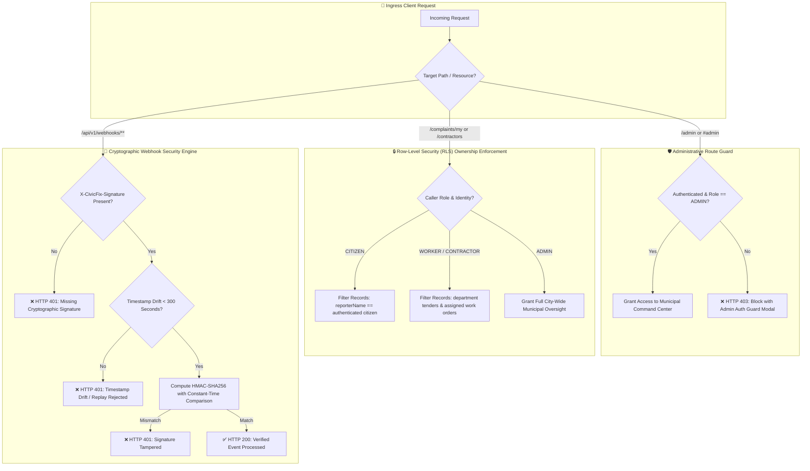

---

## 🏗️ Core Modules & Architectural Features

### 🏙️ 1. Citizen Resident Portal (`frontend`)
- **1-Click PS-09 Quick Presets**: Instant testing chips for all 5 mandated civic categories:
  - 🕳️ **Road Crater**: Deep asphalt collapse, vehicle skid hazard.
  - 🗑️ **Overflowing Waste**: Communal garbage bin spill, stray animal hazard.
  - 💡 **Dark Luminaire**: Non-functioning streetlight, nocturnal accident risk.
  - 🌊 **Monsoon Waterlogging**: Blocked stormwater canal, pedestrian flooding.
  - 💧 **Burst Water Pipe**: Potable water main rupture, pressure deficit.
- **Accurate Geolocation & Fallback**: High-accuracy GPS with automatic bounding-box validation for Bhubaneswar municipal limits, seamlessly falling back to **OUTR Campus, Kalinga Nagar, Ghatikia, Bhubaneswar (Ward 26)** if hardware GPS is coarse or denied.
- **Community Upvoting & Real-Time Confirmations**: Prevents redundant report creation by allowing nearby residents to upvote active issues, dynamically raising priority scores.
- **Interactive Verification & Rating**: Inspects before-vs-after photos and awards **1–5 Star Ratings** with quick feedback tags (`⚡ Prompt 24h SLA`, `🛠️ High Quality Fix`, `🧹 Clean Site Cleanup`, `🤝 Courteous Field Crew`).

### 🛡️ 2. Municipal Operations Command Center (`AdminCommandView`)
- **Universal Triage & Dispatch**: Filter municipal complaints across 67 wards and 5 departments; assign work orders to contractors with custom dispatch directives.
- **SLA Breach Monitoring**: Real-time countdown tracking with automated escalation when deadlines are breached (`OVERDUE` alerts).
- **GIS Defect Heatmap**: PostGIS spatial density clustering pinpointing recurring infrastructure failure clusters across the city.
- **Route-Guarded URL Security**: Any unauthorized attempt to access `/admin` or `#admin` is intercepted and blocked with an administrative credential barrier.

### 🔨 3. Contractor Workbench (`ContractorView`)
- **Tender Bidding & Work Order Acceptance**: Contractors review unassigned departmental complaints and claim tenders with 1 click.
- **Proof-of-Completion Verification Gate**: Before/after photographic upload interface; contractors are cryptographically and logically prohibited from marking tickets as `VERIFIED_RESOLVED` without citizen confirmation.
- **Dynamic Performance Score**: Live calculation of contractor rating averages (`4.8/5`) and total reviews directly driven by citizen feedback.

### ⚡ 4. Spring Boot 3 & PostGIS Backend (`backend`)
- **Spatial Duplicate Radar**: Employs PostGIS `ST_DWithin` and `ST_Distance` to detect matching reports filed within 50 meters and 72 hours, clustering them under a parent group ID.
- **Transparent 5-Factor Priority Formula**:
  $$\text{Priority Score} = \text{Severity}(0\text{--}5) + \text{PublicSafety}(0\text{--}4) + \text{PeopleAffected}(0\text{--}3) + \text{Duration}(0\text{--}2) + \text{Confirmations}(0\text{--}1)$$
  Calculates score from $0$ to $15$, mapping to strict target SLAs ($24\text{h}$ down to $120\text{h}$).
- **Row-Level Security (RLS) Service**: Role-scoped queries ensuring citizens only see their records, contractors only access their assigned work orders, and admins maintain universal oversight.

### 🤖 5. Multimodal Vision & Regional Voice AI Engine
- **Model**: `gemini-3.5-flash` with resilient fallbacks (`gemini-flash-latest`, `gemini-3.8-flash`).
- **Dynamic Key Pool Rotation**: Supports seamless rotation across 13 user Gemini API keys, stripping markdown fences (` ```json `) to guarantee deterministic schema serialization.
- **Trilingual Support**: Odia, Hindi, and Indian English voice and text recognition.

---

## 🛠️ Complete REST API Directory

| Method | Endpoint | Access Role | Description |
| :--- | :--- | :--- | :--- |
| `POST` | `/api/v1/auth/login` | Public | Authenticates citizen, contractor, or municipal official with JWT |
| `POST` | `/api/v1/auth/register` | Public | Registers new account with designated persona role |
| `GET` | `/api/v1/health` | Public | Reports backend status, database connectivity, and PostGIS 3.3.7 version |
| `POST` | `/api/v1/complaints` | Public / Citizen | Lodges new civic grievance with GPS, photo, and priority calculation |
| `GET` | `/api/v1/complaints` | Admin / Internal | Lists all municipal complaints across all departments |
| `GET` | `/api/v1/complaints/scoped` | Role Scoped | **RLS-Protected**: Returns only records owned by caller persona |
| `GET` | `/api/v1/complaints/{id}` | Authenticated | Retrieves complaint detail by UUID |
| `GET` | `/api/v1/public/complaints/{complaintId}` | Public | Public citizen tracker by human-readable ID (`CFX-2026-XXXXX`) |
| `POST` | `/api/v1/complaints/{id}/upvote` | Public / Citizen | Toggles community upvote confirmation |
| `GET` | `/api/v1/complaints/{id}/priority-breakdown` | Public | Returns transparent 5-factor mathematical score breakdown |
| `POST` | `/api/v1/complaints/{id}/transition-status` | Role Guarded | Transitions state (`IN_PROGRESS`, `AWAITING_VERIFICATION`, `VERIFIED_RESOLVED`) |
| `POST` | `/api/v1/complaints/sla/evaluate` | Admin / Cron | Evaluates and flags overdue SLA breaches across all wards |
| `POST` | `/api/v1/ai/analyze-image` | Public / Citizen | Multimodal Gemini Vision triage returning category, severity, and hazards |
| `POST` | `/api/v1/ai/transcribe-voice` | Public / Citizen | Regional Odia/Hindi/English voice transcription and entity extraction |
| `GET` | `/api/v1/ai/status` | Public | Returns Gemini Flash model status and active key configuration |
| `POST` | `/api/v1/webhooks/supabase` | HMAC Verified | Ingests database change webhooks with SHA-256 signature verification |
| `POST` | `/api/v1/webhooks/contractor-status` | HMAC Verified | Ingests contractor telemetry and repair updates with anti-replay check |
| `GET` | `/api/v1/webhooks/health` | Public | Webhook listener health status and security parameters |

---

## 💻 Technology Stack Reference

| Layer | Technology | Version | Purpose |
| :--- | :--- | :--- | :--- |
| **Frontend Framework** | React + TypeScript + Vite | 18.2 / 8.3 | High-performance responsive web and mobile application |
| **Styling & Icons** | Vanilla CSS Tokens + Lucide React | Modern | Clean municipal theme matching official design specifications |
| **Backend Framework** | Java 17 LTS, Spring Boot | 3.3.4 | Modular monolith API gateway, validation, and business logic |
| **Database** | PostgreSQL + PostGIS Extension | 14+ / 3.3.7 | Spatial geometries, index clustering, relational data storage |
| **Database Host** | Supabase AWS AP-Southeast | Session Pooler | Enterprise-grade cloud database infrastructure |
| **Multimodal AI** | Google Gemini Flash | 3.5-flash | Computer vision defect analysis & regional voice transcription |
| **Edge & CDN** | Cloudflare Tunnel / Quick Tunnels | 2026.10.7 | Instant global HTTPS edge routing and DDoS protection |
| **Security & Auth** | Stateless JWT (HMAC-SHA256) + BCrypt | Spring Security 6 | Role-based endpoint guards and session isolation |
| **Webhook Security** | Cryptographic HMAC-SHA256 | RFC 2104 | Signature validation and 300s anti-replay drift tolerance |

---

## 📂 Verified Project Structure

```text
CivicFix/
├── backend/                              # Java Spring Boot 3 Backend Service
│   ├── src/main/java/com/civicfix/
│   │   ├── config/                       # Spring Security 6 & CORS Configuration
│   │   ├── controller/                   # REST Controllers (Complaints, AI, Webhooks, Auth)
│   │   ├── dto/                          # DTOs, Priority Breakdown, Auth, Status Transitions
│   │   ├── entity/                       # JPA Entities (Complaint, User, Department, StatusLog)
│   │   ├── exception/                    # Global Exception Handler & Resource Not Found
│   │   ├── model/enums/                  # Enums (ComplaintStatus, Category, Urgency, Role)
│   │   ├── repository/                   # Spring Data JPA & PostGIS Spatial Repositories
│   │   ├── security/                     # JWT Authentication Filter & Token Provider
│   │   └── service/                      # ComplaintService, GeminiAiService, WebhookService
│   ├── src/main/resources/
│   │   └── application.yml               # Production & local profile configurations
│   ├── .env.example                      # Backend environment variable template
│   └── pom.xml                           # Maven dependencies and build definitions
├── frontend/                             # React 18 + TypeScript Vite Frontend
│   ├── public/
│   │   └── dummyimages/                  # 5 realistic high-resolution PS-09 category images
│   ├── src/
│   │   ├── components/                   # Modals (Report, Detail, Auth, Tracker), Sidebar, TopBar
│   │   ├── components/views/             # Views (Citizen, AdminCommand, Contractor, Heatmap)
│   │   ├── services/api.ts               # Axios / Fetch client for Spring Boot REST API
│   │   ├── styles/theme.css              # Custom municipal color palette and UI tokens
│   │   ├── types/                        # TypeScript domain interfaces and type definitions
│   │   └── App.tsx                       # Master App root with Route Guards & Role Switching
│   ├── package.json                      # Frontend dependencies & scripts
│   └── vite.config.ts                    # Vite config with proxy and Cloudflare host allowance
├── docs/                                 # Documentation & Architecture Assets
│   └── screenshots/                      # 14 Verified E2E Application Screenshots
├── .env.example                          # Project-wide environment configuration template
├── .gitignore                            # Comprehensive git ignore rules (*.md ignored except README)
└── README.md                             # Master Project Documentation & Quickstart
```

---

## 🚀 Getting Started & Local Development

### Prerequisites
* **Java 17 LTS** (OpenJDK, Eclipse Temurin, or Oracle JDK)
* **Node.js 18+** with `npm`
* **Apache Maven 3.8+**
* **Cloudflare CLI (`cloudflared`)** for public web exposure

---

### 1. Clone & Environment Setup
```bash
git clone https://github.com/adarsh0044321/CivicFix.git
cd CivicFix

# Copy the environment configuration template:
cp .env.example .env
```
*Configure `.env` with your database password (`SUPABASE_DB_PASSWORD`) and Gemini API keys (`GEMINI_API_KEY`).*

---

### 2. Run the Spring Boot Backend (Terminal 1)
```cmd
cd backend

:: Set environment secrets (or populate backend\.env):
set SUPABASE_DB_PASSWORD=your_supabase_password_here
set GEMINI_API_KEY=your_gemini_api_key_here

:: Start Spring Boot Server
mvn spring-boot:run
```
*Backend initializes on `http://localhost:8081` with live PostGIS 3.3.7 spatial connection to Supabase.*

---

### 3. Run the Frontend Development Server (Terminal 2)
```cmd
cd frontend

:: Install dependencies (if first time):
npm install

:: Start Vite Development Server
npm run dev -- --host --port 5173
```
*Frontend opens at `http://localhost:5173`.*

---

### 4. Expose Publicly via Cloudflare (Terminal 3)
```cmd
cloudflared tunnel --protocol http2 --url http://localhost:5173
```
*Generates an instant public HTTPS domain (`https://*.trycloudflare.com`) accessible from any phone or computer globally.*

---

## 🔑 Pre-Seeded Evaluation Credentials

The system includes pre-seeded roles ready for immediate review:

| Persona Role | Display Name | Email / Identifier | Capabilities & Permissions |
| :--- | :--- | :--- | :--- |
| **Municipal Official** | `Elena Vance` | `admin@civicfix.gov.in` | Universal triage, contractor dispatch, SLA monitoring, `/admin` route access |
| **Field Contractor** | `ABC Construction Ltd` | `worker@civicfix.gov.in` | Tender claiming, repair execution, proof-of-completion photo submission |
| **Citizen Resident** | `Citizen Resident` | `citizen@civicfix.gov.in` | Grievance lodging, community upvoting, 1–5 star rating, dispute reopening |

---

## 🔒 Enterprise Security & Compliance

CivicFix implements defense-in-depth security principles:
* **Zero Credential Leaks**: Sensitive configurations are managed strictly via `.env` and environment variables; protected by GitHub Push Protection.
* **Row-Level Security (RLS)**: Data queries are strictly scoped to the caller's persona; contractors cannot inspect private citizen communications or tamper with verification sign-offs.
* **Administrative URL Route Guard**: Appending `/admin` or `#admin` to the URL without an active administrative session triggers a blocking authentication barrier.
* **Cryptographic Webhook Verification**: All external ingress callbacks are checked against HMAC-SHA256 signatures with constant-time equality checks and a 300-second timestamp drift window to defeat replay attacks.
* **File Upload Validation**: Images are validated for MIME type, sanitized to UUID filenames, and stored safely outside the web root.

---

## 📄 License

Distributed under the **MIT License**. See `LICENSE` for complete terms.

---

## 👨‍💻 Author

**Adarsh Kumar Singh**  
*Built as an independent software project applying Multimodal AI, Spatial PostGIS Radar, and Modern Full-Stack Architecture to urban municipal redressal challenges.*
